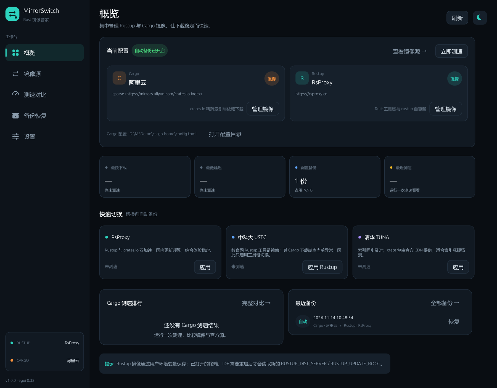
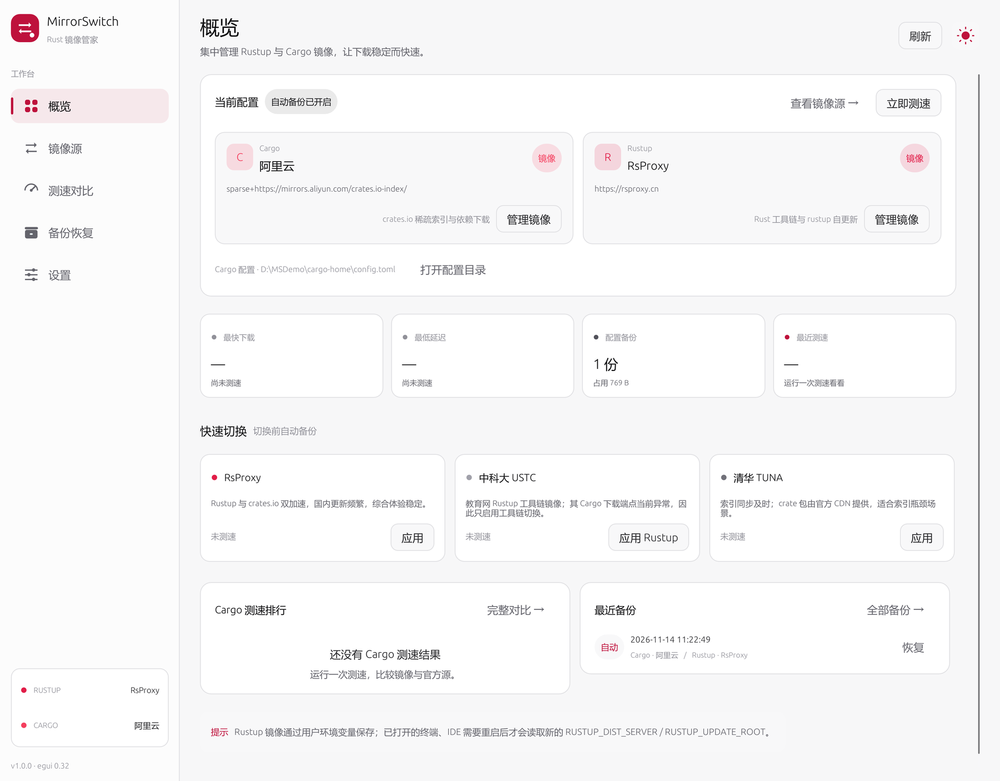
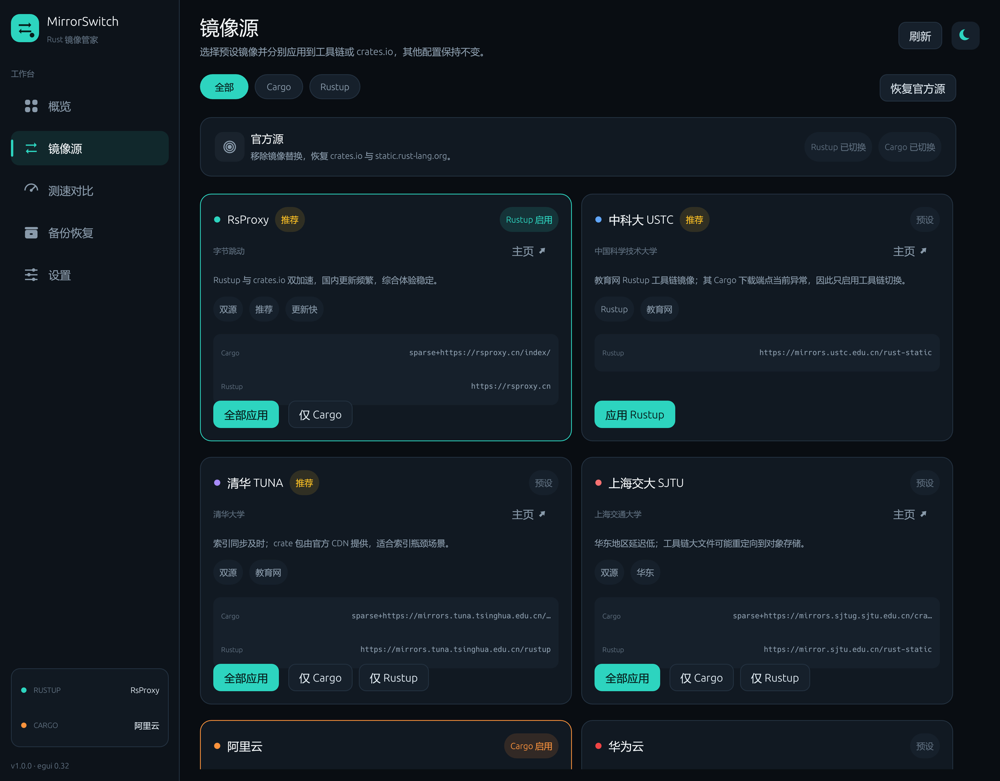
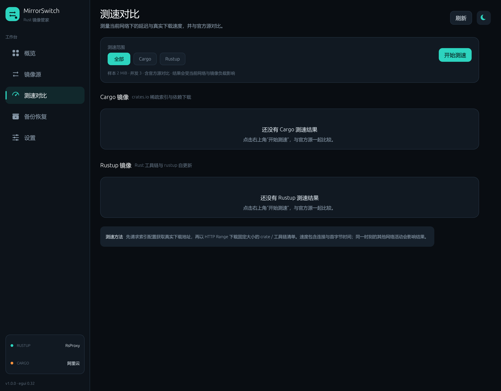
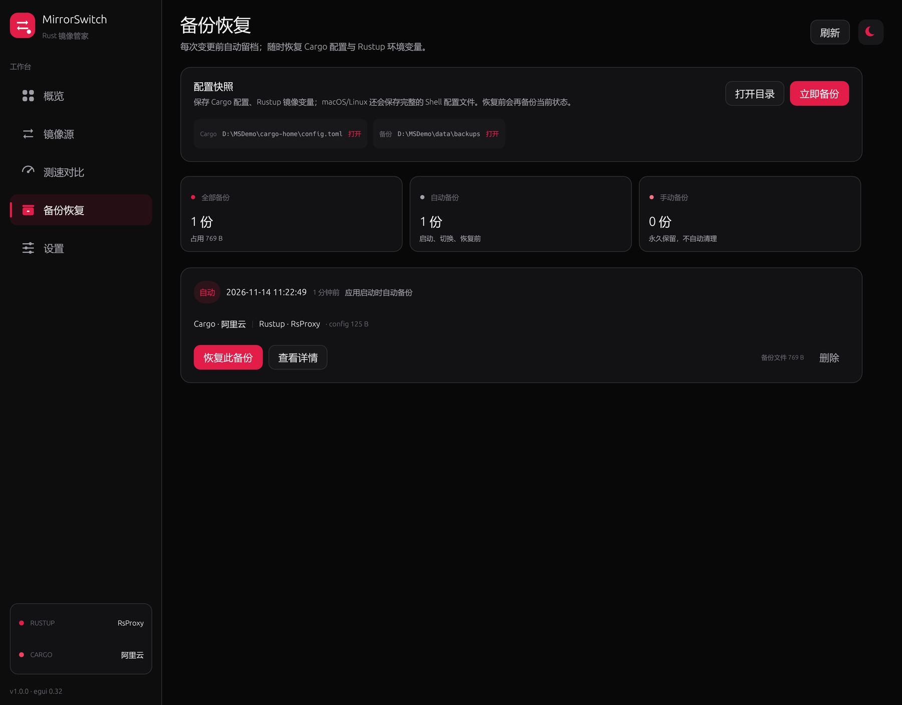
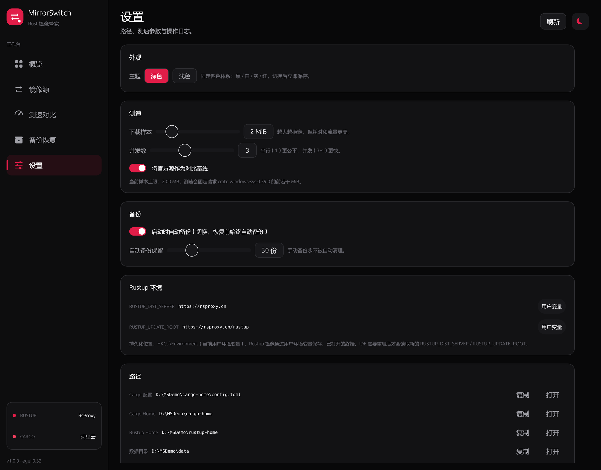

# MirrorSwitch

**Rust 镜像管家** —— 用 Rust + [egui](https://github.com/emilk/egui) 编写的 Windows / macOS 桌面工具，集中切换 Rustup / Cargo 镜像、测速对比并备份恢复配置。

[](LICENSE)




## 功能

- **双通道镜像切换**
  - Cargo：写入 `$CARGO_HOME/config.toml`，使用稀疏索引 `sparse+https://...`。
  - Rustup：
    - Windows：写入当前用户环境变量 `RUSTUP_DIST_SERVER` / `RUSTUP_UPDATE_ROOT`，并广播 `WM_SETTINGCHANGE`。
    - macOS：在 Shell 配置（默认 `~/.zshrc`）写入带标记的托管块，并调用 `launchctl setenv` 同步当前图形会话。
  - Cargo 与 Rustup 可以分别切换，也可以一键全部应用。
- **安全合并 Cargo 配置**
  - 只修改 `[source.crates-io]` 的 `replace-with` 以及本工具托管的 `mirrorswitch-*` 表。
  - 保留 `[net]`、`[build]`、私有源、注释等原有内容。
  - 检测到非法 TOML 时拒绝写入，原文件不变。
- **镜像测速与对比**
  - 测量索引探测延迟与真实下载速度。
  - 内置官方源作为基线，按综合评分排序，标出最快、最低延迟和失败原因。
  - 支持并发数、下载样本大小、是否包含官方源等设置。
- **备份与恢复**
  - 切换与恢复前**始终**自动备份；启动时自动备份可配置。
  - 手动备份永久保留；自动备份按数量滚动清理。
  - 恢复前再次备份当前状态，因此恢复本身可以撤销。
  - 备份详情可查看完整 Cargo 配置内容与当时的 Rustup 环境配置；macOS/Linux 还会保存完整的 Shell 配置文件。
- **细节**
  - 深色 / 浅色主题，统一使用黑、白、灰、红四色体系；中文界面与 CJK 字体自动检测（Windows 微软雅黑 / macOS 苹方）。
  - 操作日志、路径快捷打开/复制、失败提示。
  - Windows 单文件发布；macOS 提供 `.app` 打包脚本，无遥测。

## 快速开始

从 GitHub **Releases** 页面下载对应平台的压缩包，或按下方“构建”章节从源码构建。

### Windows

下载 `MirrorSwitch-vX.Y.Z-win64.zip`，解压后运行 `MirrorSwitch.exe`（Windows 10/11）。

本地构建：

```powershell
.\scripts\build.ps1
.\dist\MirrorSwitch.exe
```

### macOS

下载 `MirrorSwitch-vX.Y.Z-macos.zip`，解压后打开 `MirrorSwitch.app`。

从源码构建：

```bash
bash scripts/build-macos.sh
open dist/MirrorSwitch.app
```

也可以直接 `cargo run` 开发调试。macOS 11+（Apple Silicon / Intel）。

首次启动会读取当前配置；如果存在 Cargo 配置或 Rustup 镜像设置，会自动创建一份启动备份。

切换镜像后：

- **Cargo**：新开的终端立即生效。
- **Rustup（Windows）**：新开的终端、IDE、资源管理器需要重新启动，才能继承新的环境变量。
- **Rustup（macOS）**：新开的终端会读取 Shell 配置；已运行的终端/IDE 需要重启。由 Finder/Dock 启动的图形应用可能还需要重新登录，或在切换时依赖 `launchctl setenv` 更新当前会话。

## 界面

> 截图为 Windows 版本；macOS 使用原生窗口、苹方字体和相同的布局。界面统一使用黑、白、灰、红四色体系。

| 深色（默认） | 浅色 |
| --- | --- |
|  |  |

| 镜像源 | 测速对比 |
| --- | --- |
|  |  |

| 备份恢复 | 设置 |
| --- | --- |
|  |  |

## 工作方式

### Cargo 镜像

配置文件路径按以下规则确定：

1. 若设置了 `CARGO_HOME`：`$CARGO_HOME/config.toml`；
2. 否则 Windows：`%USERPROFILE%\.cargo\config.toml`，macOS/Linux：`~/.cargo/config.toml`；
3. 如果只存在旧式无扩展名文件 `config`，则继续编辑该文件。

切换时会写入类似内容：

```toml
[source.crates-io]
replace-with = "mirrorswitch-rsproxy"

[source.mirrorswitch-rsproxy]
registry = "sparse+https://rsproxy.cn/index/"

[registries.mirrorswitch-rsproxy]
index = "sparse+https://rsproxy.cn/index/"
```

其他内容保持不变。“恢复官方源”只移除 `replace-with` 和 `mirrorswitch-*` 托管表，不会动用户自己的 source 表。

> Cargo 1.68+ 才支持稀疏索引；当前受支持的稳定版 Cargo 均可使用。

### Rustup 镜像

**Windows**：只修改当前用户注册表：

```text
HKCU\Environment
  RUSTUP_DIST_SERVER
  RUSTUP_UPDATE_ROOT
```

写入成功后广播环境变量变更。不会修改 `HKLM` 系统变量，也不会改动 `rustup/settings.toml` 中的默认工具链。如果检测到系统级同名变量，界面会明确提示：系统变量优先，需管理员自行清理后才能完全恢复官方源。

**macOS / Linux**：在 Shell 配置中维护一个带标记的托管块，例如 `~/.zshrc`：

```bash
# >>> MirrorSwitch rustup mirror >>>
# Managed by MirrorSwitch. Remove this block to restore official Rustup mirrors.
export RUSTUP_DIST_SERVER='https://rsproxy.cn'
export RUSTUP_UPDATE_ROOT='https://rsproxy.cn/rustup'
# <<< MirrorSwitch rustup mirror <<<
```

- 默认根据 `$SHELL` 选择 `~/.zshrc`（zsh）、`~/.bash_profile`（bash）、`~/.config/fish/config.fish`（fish）或 `~/.profile`（sh）。
- 可用 `MIRRORSWITCH_SHELL_PROFILE=/path/to/profile` 显式指定。
- 托管块总是追加到文件末尾，以覆盖用户已有的未托管 `RUSTUP_*` 行；检测到旧行时会给出警告。
- 在 macOS 上还会调用 `launchctl setenv` / `unsetenv`，让当前图形会话中新启动的程序继承变量。
- 恢复官方源只移除托管块，不会删除用户自己的其他 export 行。

> GUI 应用（例如从 Dock 启动的 IDE）不会读取 `.zshrc`。`launchctl` 只影响当前登录会话；若重启后需要让 GUI 应用继承镜像变量，请从终端启动该应用，或使用专门的 launchd 配置。终端中的 `rustup` / `cargo` 使用 Shell 配置即可。

## 内置镜像

所有地址在 2026-11-13 按镜像站帮助页与实际端点核对。

| 镜像 | Cargo 索引 | Rustup DIST / UPDATE | 备注 |
| --- | --- | --- | --- |
| RsProxy（字节跳动） | `sparse+https://rsproxy.cn/index/` | `https://rsproxy.cn` / `https://rsproxy.cn/rustup` | 双源，推荐 |
| 中科大 USTC | 暂不启用 | `https://mirrors.ustc.edu.cn/rust-static` / `.../rustup` | Cargo 下载端点当前异常 |
| 清华 TUNA | `sparse+https://mirrors.tuna.tsinghua.edu.cn/crates.io-index/` | `https://mirrors.tuna.tsinghua.edu.cn/rustup` / `.../rustup` | crate 包回源官方 CDN |
| 上海交大 SJTU | `sparse+https://mirrors.sjtug.sjtu.edu.cn/crates.io-index/` | `https://mirror.sjtu.edu.cn/rust-static` / `.../rustup` | 大文件可能重定向到对象存储 |
| 阿里云 | `sparse+https://mirrors.aliyun.com/crates.io-index/` | `https://mirrors.aliyun.com/rustup` / `.../rustup` | 公网覆盖广 |
| 华为云 | `sparse+https://mirrors.huaweicloud.com/repository/rust/crates.io-index/` | `https://mirrors.huaweicloud.com/rustup` / `.../rustup` | 政企/云内网络 |

> **USTC Cargo 为何未启用？** 其 2026-11-13 的 `config.json` 宣告下载地址为
> `https://mirrors.ustc.edu.cn/crates/api/v1/crates`，实测返回 404；可用地址实际是
> `/crates.io/api/v1/crates`。为避免写入一个“能更新索引但无法下载 crate”的配置，
> 工具只启用其 Rustup 镜像。等镜像站修复后可恢复 Cargo 端点。

## 测速方法

- **Cargo**
  1. 请求镜像的 `config.json`，测得连接 + 首字节延迟；
  2. 从镜像声明的 `dl` 地址以 HTTP Range 下载固定长度的真实 crate（`windows-sys 0.59.0`）样本；
  3. 校验 gzip 头，计算下载吞吐。
- **Rustup**
  1. 请求 `rustup/release-stable.toml` 测延迟；
  2. 下载 `dist/channel-rust-stable.toml` 的固定长度样本并校验内容。
- **官方源**作为对比基线一起测试。
- 综合评分（0–100）：

```text
score = 0.8 × min(下载速度 / 20 MiB/s, 1) × 100
      + 0.2 × clamp(1 - 延迟 / 1000 ms, 0, 1) × 100
```

测速会受带宽共享、镜像负载、代理和 DNS 影响。需要更公平的横向对比时，将并发数设为 1 并重复测试。请求遵循系统代理设置；若镜像不可达，失败原因会显示在结果表的“失败”标记悬停提示中。

## 备份与恢复

备份保存在数据目录的 `backups/` 下，每份是一个 JSON 文件，包含：

- Cargo 配置文件是否存在、完整原文、路径与解析摘要；
- 当时的 `RUSTUP_DIST_SERVER` / `RUSTUP_UPDATE_ROOT` 用户值，以及实际生效值；
- macOS/Linux 上完整 Shell 配置文件的内容（用于精确恢复托管块所在文件）；
- 类型（启动自动 / 切换前自动 / 手动 / 恢复前）、时间、备注、格式版本。

**恢复会把 Cargo 配置和 macOS/Linux Shell 配置恢复为快照时的完整内容，因此会覆盖快照之后对这些文件做的其他修改。** 由于恢复前会自动再备份当前状态，可以在应用内撤销。

默认数据目录：

Windows：

```text
%APPDATA%\MirrorSwitch\
  settings.json
  last_speed.json
  backups\
  logs\mirrorswitch.log
```

macOS：

```text
~/Library/Application Support/MirrorSwitch/
  settings.json
  last_speed.json
  backups/
  logs/mirrorswitch.log
```

若默认目录不可写，会依次尝试其他用户数据目录和 `~/.mirrorswitch`。也可以显式指定：

```powershell
# Windows PowerShell
$env:MIRRORSWITCH_DATA_DIR = "D:\Portable\MirrorSwitch"
.\MirrorSwitch.exe
```

```bash
# macOS / Linux
MIRRORSWITCH_DATA_DIR="$HOME/Portable/MirrorSwitch" ./MirrorSwitch
```

备份是**明文 JSON**，可能包含私有 registry URL 和 Shell 配置内容。请像保护原配置文件一样保护备份目录。

## 安全边界

- 只修改：
  - Cargo 配置文件；
  - Windows：`HKCU\Environment` 中两个 Rustup 变量；
  - macOS/Linux：Shell 配置中的 MirrorSwitch 托管块；
  - 本应用数据目录。
- 不修改：`rustup/settings.toml`、已安装工具链、`credentials.toml`、SSH 密钥、Windows 系统级环境变量。
- 不写入非法 TOML；切换前备份失败时会中止切换。
- 恢复备份时会针对当前解析到的 Cargo / Shell 路径写入，而不是盲目信任备份中的旧路径；路径不一致会提示。
- Shell 配置采用追加式托管块，重复切换不会产生多个块。
- 无网络请求以外的后台行为，无遥测。

## 文档

- [架构与安全不变量](docs/ARCHITECTURE.md)
- [Ubuntu 兼容设计方案（规划）](docs/UBUNTU.md)
- [发布流程](docs/RELEASING.md)
- [贡献指南](CONTRIBUTING.md)
- [行为准则](CODE_OF_CONDUCT.md)
- [安全政策](SECURITY.md)
- [获取帮助](SUPPORT.md)
- [更新日志](CHANGELOG.md)

## 构建

需要 Rust 1.88+。首次构建需要联网下载依赖。

### Windows

需要 MSVC 工具链：

```powershell
rustup show
cargo build --release
# 产物：target\release\MirrorSwitch.exe
```

一键构建并打包（含 README、许可证和截图）：

```powershell
.\scripts\build.ps1
# 产物：dist\MirrorSwitch-v1.0.0-win64.zip
```

`.cargo/config.toml` 为 Windows 目标静态链接 MSVC CRT，发布单个 exe 不依赖额外 VC++ 运行库。

### macOS

需要 Xcode Command Line Tools（`xcode-select --install`）：

```bash
cargo build --release
# 裸二进制：target/release/MirrorSwitch
```

构建 `.app` 并打包：

```bash
bash scripts/build-macos.sh
# 产物：dist/MirrorSwitch.app
#       dist/MirrorSwitch-v1.0.0-macos.zip
```

脚本会生成 `.icns` 图标、写入 `Info.plist`、执行 ad-hoc codesign，并打包 README/许可证/截图。需要通用二进制（Apple Silicon + Intel）时：

```bash
UNIVERSAL=1 bash scripts/build-macos.sh
```

脚本会通过 `rustup target add` 安装两个 macOS 目标并用 `lipo` 合并。

> 首次打开未公证的本地构建时，macOS Gatekeeper 可能拦截。可在 Finder 中右键“打开”，或执行：
> `xattr -dr com.apple.quarantine dist/MirrorSwitch.app`。正式分发建议使用 Developer ID 签名并公证。

开发运行：

```bash
cargo run
```

## 测试

```powershell
cargo test
```

覆盖 Cargo 配置合并/回滚、TOML 保护、Shell 托管块解析/写入（zsh/bash/fish）、快照去重/恢复、备份清理、评分、URL 构造以及一个本地 HTTP 测速端到端测试。

macOS 交叉编译检查：

```bash
cargo check --target aarch64-apple-darwin
cargo check --target x86_64-apple-darwin
```

可选的真实网络探测：

```powershell
cargo test live_probe -- --ignored --nocapture
```

> 该测试会真实请求所有镜像并下载样本，耗时取决于网络。

## 目录结构

```text
src/
  main.rs       窗口、图标、启动
  app.rs        五个页面、交互与状态
  catalog.rs    内置镜像目录与 URL 规则
  cargo.rs      Cargo config.toml 安全合并
  platform.rs   Windows 注册表 / macOS Shell 环境持久化
  shell.rs      zsh/bash/fish 托管块解析与写入
  backup.rs     快照、恢复、清理
  speedtest.rs  并发测速与评分
  state.rs      当前配置探测
  theme.rs      深/浅色主题与 CJK 字体
  widgets.rs    自绘控件
  screenshot.rs egui 离屏截图（文档/验收）

packaging/macos/Info.plist   macOS .app 元数据
scripts/build.ps1            Windows 打包
scripts/build-macos.sh       macOS .app / 通用二进制打包
```

## 已知限制

- macOS 的 Shell 托管块覆盖终端中的 Rustup；从 Dock 启动的 GUI 应用需要重新登录或从终端启动，才能稳定继承环境变量。
- `launchctl setenv` 只作用于当前登录会话，不跨重启持久化。
- 仅自动识别 zsh/bash/fish/sh 的默认配置文件；可通过 `MIRRORSWITCH_SHELL_PROFILE` 覆盖。
- 镜像可用性会变化，内置地址不保证永久有效。
- USTC 的 Cargo 镜像目前未启用，原因见上。
- 代理认证、企业证书等复杂网络环境不做单独配置界面，跟随系统代理。
- 未提供“自定义镜像”表单；可通过直接编辑 Cargo 配置或修改 `catalog.rs` 扩展。

## 贡献

欢迎提交 Issue 和 Pull Request。开始前请阅读 [CONTRIBUTING.md](CONTRIBUTING.md)；安全问题请按 [SECURITY.md](SECURITY.md) 私下报告。

## License

本项目使用 MIT 协议，见 [LICENSE](LICENSE)。
